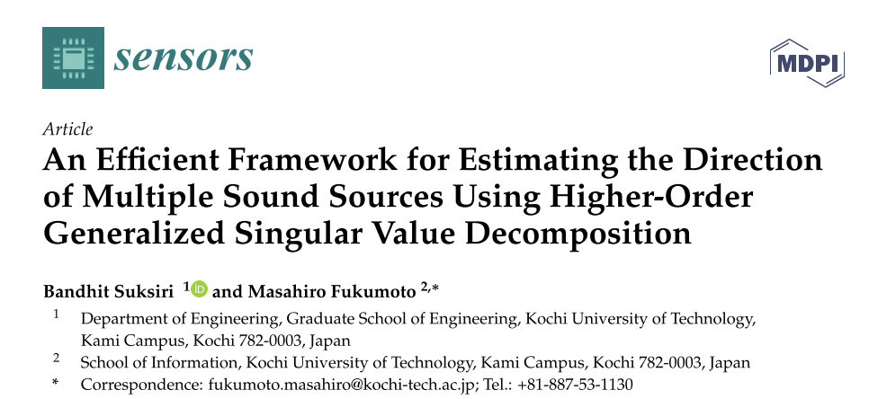
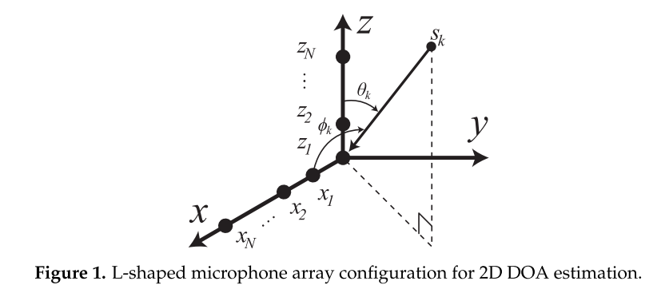
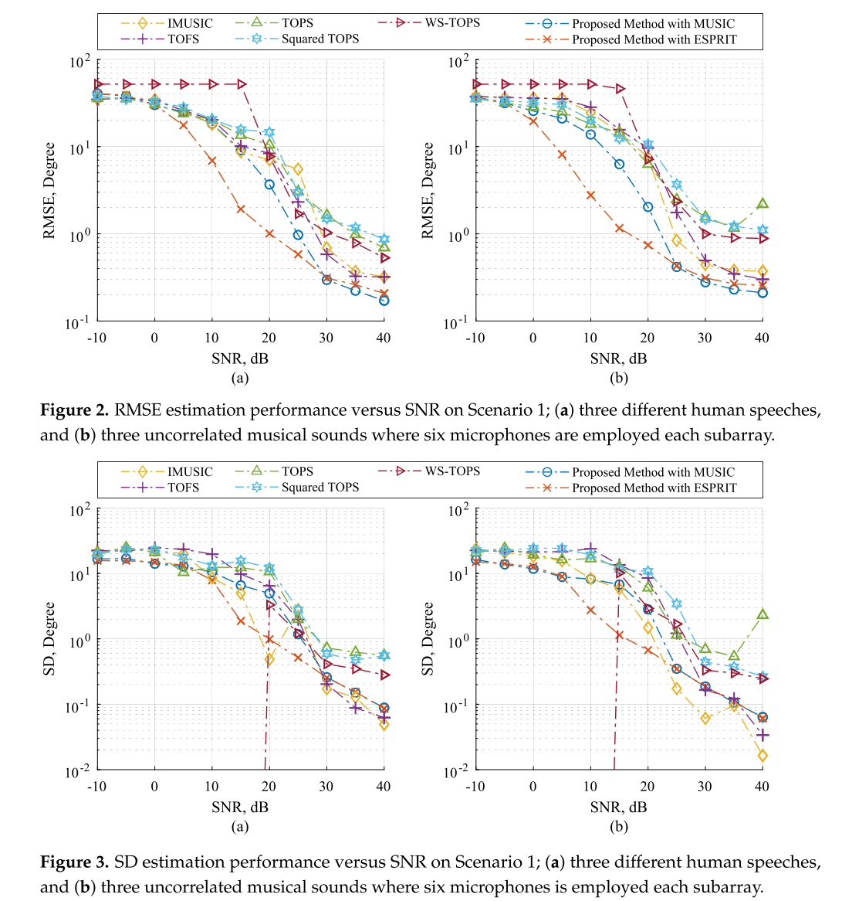
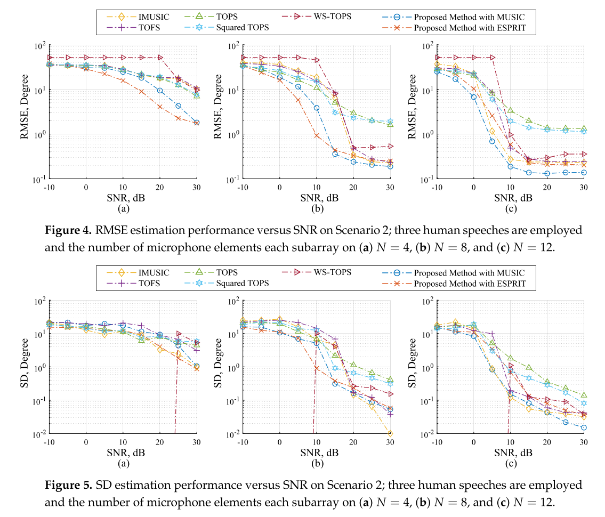
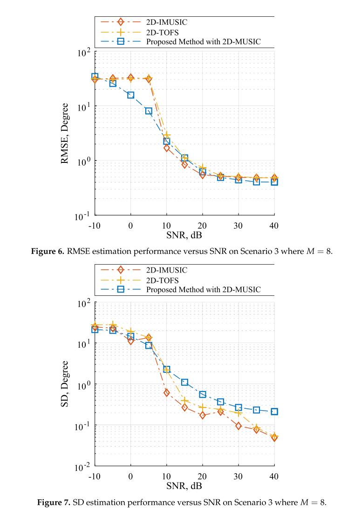
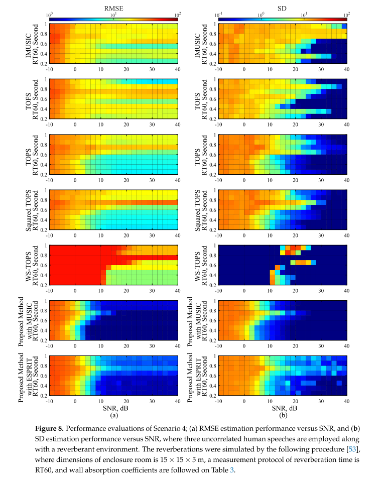
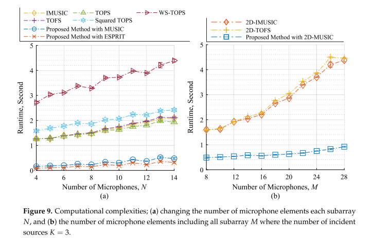
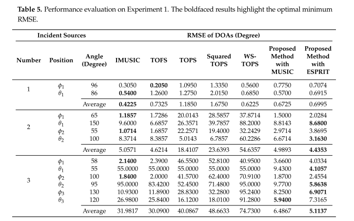
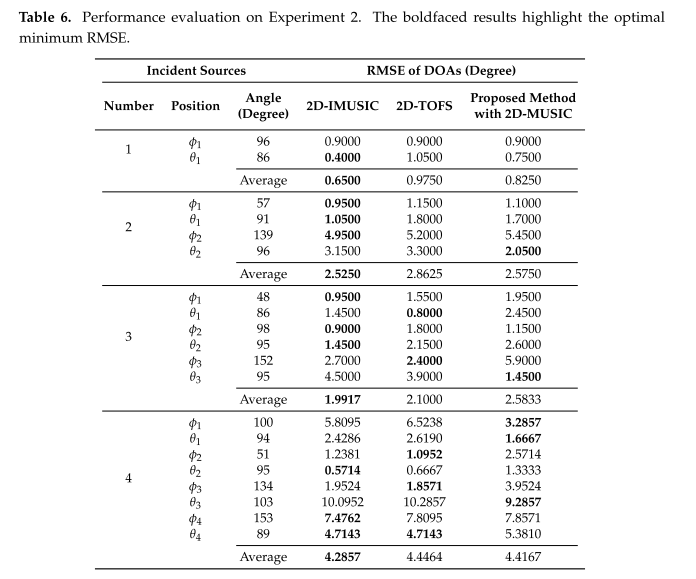

# DOA Estimation Based on Higher-Order Generalized Singular Value Decomposition: A Multi-Source Direction Estimation Method [with MATLAB Code]

Introduction: A Multi-Band Source Direction Estimation Method Based on Higher-Order Generalized Singular Value Decomposition
In the estimation of narrowband DOA, alternative methods have been proposed to enhance estimation performance. The subspace method is one such approach that strives to improve estimation accuracy by observing signal and noise subspaces for more robust results. For instance, Multi-Signal Classification (MUSIC) [12] estimates signal parameters through rotation invariant techniques (ESPRIT) [13], and propagation operator methods [14, 15] are often used for one-dimensional (1D) DOA estimation along uniform linear arrays of sensors. In the case of two-dimensional (2D) DOA estimation, a new geometric structure of the sensor array is required, and previously discovered L-shaped array structures have proven quite effective for estimating 2D DOA [16]. Additionally, the L-shaped array allows for simple implementation due to its structure consisting of two Uniform Linear Arrays (ULAs) connected orthogonally at each antenna. As a result, the L-shaped array has been widely applied in 2D DOA estimation methods [17-26] and has found practical applications in past research [27, 28]. Although narrowband subspace methods may not directly estimate broadband DOA, one potential solution to this problem involves using the narrowband subspace method at each time-frequency bin, followed by interpolating the narrowband DOA results to all frequency points to estimate broadband DOA results [29, 30]. It should be noted that the above solutions may encounter high computational costs due to practical considerations.
Several methods have been proposed to address the problem of estimating wideband DOA, such as non-coherent MUSIC (IMUSIC) being one of the simplest approaches [31]. The IMUSCI algorithm is divided into two steps: first, construct a noise subspace model at each time-frequency point. Then, by minimizing the orthogonality between the steering vector and the noise subspace at all frequency points, the wideband DOA can be obtained. Although the accuracy performance of IMUSCI has been proven to be an effective method for estimating DOA in high signal-to-noise ratio (SNR) regions, a small distortion in any frequency's noise subspace can affect the entire DOA result. Recently, many attempts have been made to overcome this issue. For example, the Frequency Subspace Orthogonality Test (TOFS) was proposed to overcome this difficulty [32], but the performance degradation caused by small distortions remains challenging. Another related method is called Projection Subspace Orthogonality Test (TOPS) [33]. The TOPS algorithm estimates DOA by constructing a reference frequency signal subspace and then measuring the orthogonality between the previous reference frequency signal subspace and the noise subspace at all frequency points. Simulation results show that within the range of moderate SNR, the TOPS algorithm can achieve higher estimation accuracy than the IMUSCI algorithm, but unwanted spurious peaks still exist. Recently, revisions and significant improvements of the TOPS were proposed to reduce these spurious peaks [34, 35]. It is evident that compared with classical TOPS, the computational complexity significantly increases.
Another noteworthy method for broadband DOA estimation is the Coherent Signal Subspace (CSS) approach [36, 37]. The CSS specifically focuses each time-frequency received signal correlation matrix into a singular matrix associated with a focused frequency by means of a linear transformation process. This singular matrix is referred to as the universal correlation. Broadband direction of arrival (DOA) estimation employs a single plan on the universal correlation matrix from any narrowband subspace method. In addition to the transformation process of the CSS [38-40], preliminary DOA estimation is also required before estimating the broadband DOA. Therefore, a common shortcoming is the clear recognition that as a preliminary estimate of DOA, this implies that any poor starting point can lead to biased estimates. According to literature [31-33, 41], the CSS shows inferior performance compared to other methods such as TOPS; this is because the solution in the transformation process of the CSS only focuses on the subspace between time-frequency and focused frequency; it is known that this means that the basic components of the transformation matrices across all frequency bins can exhibit different core components, which becomes evident when the narrowband DOA results at a certain frequency are not close enough to the true DOA. Distortion in individual components affects the overall estimation of DOA. Therefore, even if the power in the received signal at that frequency is very weak, the solution must exhibit precise components; in other words, focus must be on all frequency bins rather than different frequency pairs.
The purpose of this paper is to investigate an improved method for estimating broadband Direction of Arrival (DOA). We consider the acoustic sources of broadband sources, such as human speech and music. To estimate broadband DOA, we address the problem of converting multiple narrow-band cross-correlation matrices into a broadband cross-correlation matrix. Additionally, inspired by the CSS computation model, our research further improves the linear transformation process [36 - 40]. As the CSS transformation process focuses only on subspaces between current and reference frequencies, as previously mentioned, we propose a new transformation process that simultaneously and effectively concentrates all frequency bins. Higher-order Generalized Singular Value Decomposition (HOGSVD) is first used to solve this important problem [42]. By adopting the novel unique array of cross-correlation matrices with HOGSVD, where elements in rows and columns are sample cross-correlations between received signals at two different frequencies, the new transformation process no longer requires any preliminary estimation of DOA. Finally, the construction of broadband cross-correlation matrices is achieved through the proposed transformation process, and broadband DOA estimation can employ any subspace-based technique to estimate narrow-band DOA, but using this broadband correlation matrix instead of the narrow-band correlation matrix. Therefore, this framework enables cutting-edge research to directly estimate broadband source DOA from recent narrow-band subspace methods, leading to reduced computational complexity and promoting estimation algorithms. Through practical examples such as two-dimensional MUSIC and L-shaped array ESPRIT, the applicability and effectiveness of this method are verified.
The rest of this article is organized as follows. Section 2 introduces the array signal model, basic assumptions, and problem formulations for converting all frequency point narrow-band sample cross-correlation matrices into a single matrix, referred to as the wide-band cross-correlation matrix. Section 3.1 describes the description of the new transformation process, while Section 3.2 discusses the effective solution through the HOGSVD. Section 3.3 outlines the proposed framework for estimating wide-band DOA by combining the proposed transformation process with the recent narrow-band subspace method for DOA estimation, and provides practical examples in Section 3.3.1 and Section 3.3.2. Simulation results and experimental results are compared with several existing methods in Sections 4 and 5. Finally, Chapter 6 summarizes the paper.
System Model
Simulation Verification In this section, the performance of the proposed framework's fusion method is demonstrated across four types of scenarios: (1) the performance relative to the selected method and the proposed method against source types, (2) the performance relative to the number of microphone elements, (3) the performance considering the automatic pairing of x and z subarray angles, and (4) the performance under reverberation conditions. Scenarios 1, 2, and 4 must find the DOA of x and z subarray angles using data model (2) separately. Scenario 3 must find the DOA of x and z subarray angles simultaneously considering automatic pairing using data model (1). We provide simulation tests against the following methods: IMUSCIC [31], TOFS [32], TOPS [33], Squared-TOPS [34], WS-TOPS [35]. Note that these tests exclude methods based on CSS; since non-expected biases due to the preliminary DOA estimation process should be considered as discussed in other candidate methods in literature [31-33,41].
Scenario 1: Performance Against Source Type
​
Figures 2 and 3 compare the performance of the selected method with that of the proposed method in terms of RMSE and SD within the SNR range. The proposed method incorporates modified MUSIC from equation (45) and ESPRIT from equations (50)-(52). Each subarray consists of six microphone elements, and three uncorrelated source angles (φk, θk) are placed at (41.41°, 60°), (60°, 45°), and (75.52°, 30°). In Figures 2a and 3a, the sources are human speech. In Figures 2b and 3b, the sources are recorded sounds on a piano, including various monochromatic notes and a sampling frequency ranging up to 48 kHz. It is important to note that not all signal sources are stationary. The results in Figures 2 and 3 indicate that the proposed method with ESPRIT can effectively handle both types of source compared to other candidate methods with acceptable SNR ranges. Subsequently, observing the 40 dB SNR in Figures 2 and 3 is interesting, where IMUSI, TOFS, and the proposed method incorporating MUSIC and ESPRIT show very low RMSE, demonstrating good DOA estimation. When the SNR drops to 25 dB, IMUSI and TOFS start showing worse RMSE quality than the proposed method, which is significantly higher, and it is clear that when the SNR drops to 10 dB, all tested methods significantly outperform each other, but the proposed method with ESPRIT still maintains a more satisfactory result compared to other methods. It should be noted that IMUSI and TOFS require sensor element counts far exceeding source counts to achieve comparable results [31-33, 41]. Therefore, the simulation results in Figures 2 and 3 provide evidence that when the incident sources are broadband and non-stationary signals, the proposed method performs better than other candidate methods in estimation. Although the performance of the MUSIC method is also affected by noise, its overall performance remains superior to other methods.
Scene 2: Performance Comparison of Methodologies Regarding Number of Microphone Elements
Figures 4 and 5 present the performance comparison of the selected methodologies and the proposed method in terms of RMSE and SD within the SNR range. The three unrelated source angles are human voices, placed as previously. Firstly, let's start with the twelve microphone cases shown in Figures 4c and 5c. IMUSIC, TOFS, and WS-TOPS demonstrate very low RMSE levels within a SNR range of 15 to 30 dB; this is because their performance significantly depends on the number of sensor elements rather than the number of sources [31-33, 41]. Similarly, the proposed methodologies also show very low RMSE compared to MUSIC and ESPRIT, which may imply that the proposed methodologies, IMUSIC, TOFS, and WS-TOPS, have particularly effective wideband DOA estimation capabilities. However, for practical applications, it should be considered that fewer microphone elements are preferable. The performance of the selected methodologies is determined by the number of microphone elements in each subarray, as shown in Figures 4b and 5b. Moreover, when four microphones are used as shown in Figures 4a and 5a, the performance of the selected methodologies significantly drops. The reason is that unwanted spurious peaks appear in the spatial spectrum of the selected methodologies due to noise perturbation; when the power of noise at a certain frequency exceeds or is greater than the power of sources, the orthogonality between the noise subspace and search space may not be sufficient to prevent false alarm peak occurrences [41]. Conversely, the RMSE performance of the proposed methodologies also dominates but is lower than other methods, as demonstrated simultaneously across all frequency bins as described in Section 3. Therefore, the proposed methodologies provide better RMSE performance compared to others, indicating that the dependence between microphone element and source numbers can be relaxed. This substantial capability is more meaningful for many practical applications.
Scene 3: Considering Performance with Auto-Pairing
The scenario also estimates the DOA of both x and z subarrays simultaneously, considering automatic pairing and adhering to the data model in equation (1). As shown in Figure 1, an L-shaped array structure composed of two ULA's, some research works estimate the DOA of x and z subarrays separately by performing 1D DOA estimation on each subarray [17-26]. When using more than one source, these algorithms require an additional angle pair matching process to map the relationship between the two independent subarray angles. For example, the corresponding angle pairs are found by re-arranging ax(φk, f) with the fixed right side of the array manifold of the z subarray. It should be noted that the pairing process may lead to performance degradation caused by pairing errors. To achieve automatic pairing without a pairing process, we choose the modified 2D-MUSIC from equation (44) as the method proposed in this case. Additionally, TOPS, Squared-TOPS, WS-TOPS are excluded in these tests because they only support the RISK model. Note that the 2D peak search algorithm is employed on 2D-IMUSIC, 2D-TOFS, and the proposed method. Figures 6 and 7 show the performance comparison of the proposed method with RMSE and SD within the SNR range for 2D-IMUSIC, 2D-TOFS, and the proposed method, including 8 microphone elements per subarray, three unrelated source angles being human speech, and placed as before. Figure 6 indicates that when the SNR increases above 10 dB, the proposed 2D-MUSIC method exhibits very similar overall performance to 2D-IMUSIC and 2D-TOFS; however, the computational burden of the proposed method can significantly be lower than other methods, which will be further revealed in Section 4.5.
The method proposed in this scenario is a modified MUSIC and ESPRIT using the data model from Equation (2) to estimate DOA for both x and z subarray angles without considering automatic pairing. The performance metrics of RMSE and SD are compared with other methods that have been proposed in the literature, such as the modified MUSIC and ESPRIT from Equations (45) and (50)-(52), respectively. The simulation was conducted using the program [53] to simulate reverberation, where the absorption coefficients of the walls were simulated as shown in Table 3, with a closed room size of 15 × 15 × 5 m and a measurement protocol of RT 60, ranging from 200 to 1000 ms for the reverberation time. Three uncorrelated source angles were used in the same way as previously, and the number of microphone elements per subarray was set to 12. Figure 8 shows the performance comparison between the selected method and the proposed method, with color codes on the curve graphs representing RMSE and SD estimation performance, respectively. The vertical axis represents the reverberation time, and the horizontal axis represents the SNR range. Simulation results from Figure 8 indicate that reverberation significantly affects the RMSE and SD performance of both the selected method and the proposed method, especially under high noise levels and long reverberation times. As the reverberation time decreases, all selected methods start to demonstrate lower RMSE. This suggests that in practical applications, it is essential to consider the trade-off between reverberation robustness and SNR level, such as applying reverberation cancellation or noise cancellation techniques to provide more reliable RMSE and SD estimation performance. However, the proposed method, which outperforms other methods in terms of reverberation time index and SNR level range between 10 and 40 dB, regardless of the trade-off, can support its performance being particularly effective for wideband DOA estimation in reverberant environments.
Computational complexity
The computational complexity of the proposed method was evaluated, using execution time measurements in a stable environment. We present the computational complexity compared to the following scenarios: (1) calculating the direction of arrival (DOA) for both x and z subarray angles as shown in Figure 9a, and (2) simultaneously calculating the DOA for both subarray angles as shown in Figure 9b. Note that the computational burden of the peak search algorithm is relevant in this study, where the number of search angles per subarray is 180. It is evident from Figure 9 that the computational time for other methods shows a higher growth rate than the proposed method. This is because the peak search algorithm may have a high execution time, and almost all selected methods require dense computation through testing the orthogonality of the narrow-band sample cross-correlation matrix subspace and search space across all frequency bins, which leads to high computational costs. In contrast, the proposed method transforms all narrow-band sample cross-correlation matrices across all frequency bins into a single matrix as shown in Equations (33)-(35), and this matrix contains useful information about the source cross-correlation matrix across all frequency bins, such as 1 P ∑ Pi =1 S{ fi,fi}; in other words, the test for the orthogonality of the subspace and search space can be completed using the broadband cross-correlation matrix instead of all narrow-band sample cross-correlation matrices. Therefore, the computational complexity of the proposed method is significantly lower than other methods, confirmed by the test results in Figure 9.
Experimental conclusions The performance of the proposed method was tested in this section with the same experimental parameters as in the previous simulations, except for the following: we used human speakers as sources of original speech with random sentences. Continuous recordings were made 20 times, each recording approximately 1 min long, segmented into 3-second intervals. The microphone structure is shown in Figures 1 and 10, and the specifications of the microphone and its recording device are shown in Table 4. The experiment was conducted in an indoor conference room, whose size is shown in Figure 11, with a normal sound pressure level of 46.6 dBA and a reverberation time estimated at 219ms based on RT60.
Considering two scenarios: (1) separately estimating the DOA of x and z subarrays, and (2) simultaneously estimating the DOA of x and z subarrays in the context of automatic pairing. In the case of experiment 1, the proposed method is modified MUSIC from equation (45) and ESPRIT from equations (50)-(52), compared with methods such as IMUSI [31], TOFS [32], TOPS [33], Squared-TOPS [34], and WS-TOPS [35]. In the case of experiment 2, compared with 2D-IMUSIC [31] and 2D-TOFS [32], the proposed method is the modified 2D-MUSIC from equation (44).
Tables 5 and 6 compare the performance of the selected methods with those proposed in terms of RMSE within the range of source numbers, Table 5 for Experiment 1 and Table 6 for Experiment 2. The bold results highlight the optimal minimum RMSE for each problem. As shown in Table 5, when using a single source, IMUSI'C performs the lowest RMSE, but the performance of other methods including the proposed ones also shows similar low RMSE within an acceptable error margin. When performing two sources, TOPS, Squared-TOPS, and WS-TOPS dominate directly, while IMUSI'C, TOFS, and the proposed methods slightly hold their positions but still maintain good enough performance. When the number of incident sources increases to three, we clearly see that the performance of IMUSI'C, TOFS, TOPS, Squared-TOPS, and WS-TOPS is significantly dominated by the number of incident sources, as these methods require a much higher number of sensor elements than the number of sources to achieve reasonable good results, which can be verified through references to Section 4 and Figures 4 and 5. However, the proposed methods can effectively estimate the DOA of three sources and outperform the selected methods. This is because the proposed methods focus on all frequency bins simultaneously rather than individually focusing on each band, as stated in Section 3.2. In the case of Experiment 2 in Table 6, experimental results show that the proposed method with 2D-MUSIC exhibits overall performance extremely similar to that of 2D-IMUSIC and 2D-TOFS. As already stated in Section 4.5, the computational complexity of the proposed method is definitely lower than that of 2D-IMUSIC and 2D-TOFS, as these methods check the orthogonality of subspaces and search over narrowband sample cross-correlation matrices for all frequencies, leading to very high computational requirements. The proposed method tests the orthogonality of subspaces and search spaces using broadband sample cross-correlation matrices instead of narrowband sample cross-correlation matrices for all frequency bins, but it is sufficient to demonstrate significant effects as well as using narrowband sample cross-correlation matrices for all frequency bins. Finally, the experimental results from Tables 5 and 6 provide evidence that the proposed method has better estimation performance compared to other methods based on the number of event sources.
A summary of an effective method for estimating the direction of arrival (DOA) of a broadband sound source is presented. By focusing on the signal subspace of all frequency bins simultaneously instead of pairing time and reference frequencies as in the CSS-based methods, we successfully tackled the issue of transforming multiple narrowband cross-correlation matrices used across all frequency bins into a broadband cross-correlation matrix. A new solution to this problem was provided through the application of the HOGSVD to the new cross-correlation matrix array, where elements in both rows and columns are the cross-correlation matrices between the received signal and itself at two different frequencies. Theoretical analysis indicates that this transformation method can achieve an optimal solution under appropriate constraints without the need for preliminary DOA estimation. Subsequently, we provided an alternative approach to construct a broadband cross-correlation matrix by the proposed transformation process, which makes it easy to use this broadband matrix to estimate the direction of arrival along with any single-frequency space method. One of the main contributions of this paper is the proposed framework, which enables cutting-edge research to directly estimate the broadband DOA of a broadband source using recent narrowband subspace methods, leading to reduced computational complexity and convenient estimation algorithms. We also conducted several examples using the proposed framework, such as L-shaped microphone arrays integrated with 2D-MUSIC, MUSIC, and ESPRIT methods. Additionally, simulations and experimental results show that the fusion method using the proposed framework has good fusion performance compared to other broadband DOA estimation methods. It has better estimation performance within the SNR range, with fewer sensors, less noise, and reverberation conditions. We believe that this method is an effective broadband DOA estimation method that not only enhances acoustic signal processing for broadband DOA estimation but also has potential applications in other related fields.

## Images

<!-- PAYMENT_BLOCK -->

## Get this dataset

- Payment link (Stripe): [Buy now](https://buy.stripe.com/3cs8yP7sY87d0vu9AB)
- Payment QR code: 

<!-- /PAYMENT_BLOCK -->
